# Lead Coding Agent (LCA) Playbook

The **Lead Coding Agent (LCA) Playbook** is a harness-agnostic, model-agnostic
engineering methodology and CLI toolkit for agent-led software development
(`Apache-2.0`).

Modern coding agents write code fast; the bottleneck has not stopped being
engineering, it has **moved**. Output quality tracks specification and
architectural clarity directly: hand an agent a blurry wish and it will etch
every ambiguity straight into code; pair senior engineering judgment with crisp,
intentional specifications and a small disciplined team can ship verified
software at remarkable scale while still understanding every part of the system.

Use it with Claude Code (`claude`), OpenAI Codex (`codex`), Google Antigravity
(`agy`), Grok CLI (`grok`), OpenCode, or any capable coding-agent harness.

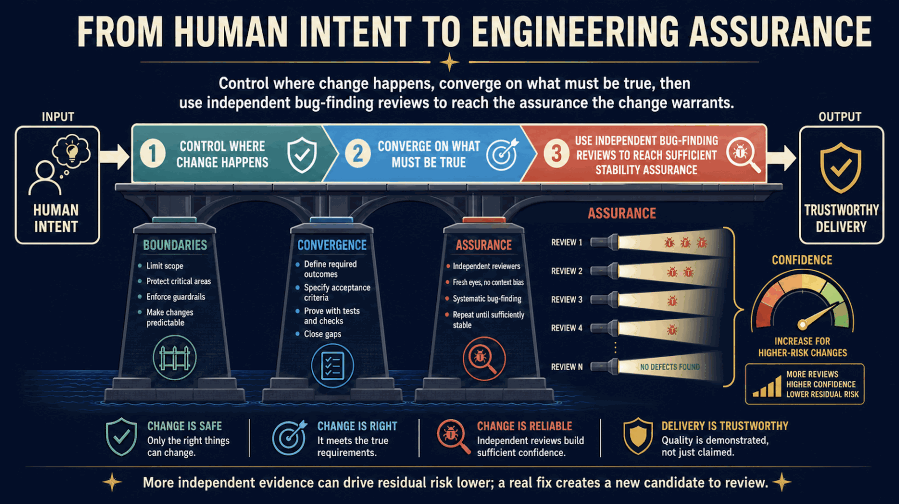

---

## Video Walkthroughs

Click any card to open the **[interactive 1080p walkthrough player](https://m4thnerd.github.io/lca_playbook/)** (with chapter jump buttons and `1x`-`2x` speed controls), or download the MP4s from the **[v1.0.0 release](https://github.com/m4thnerd/lca_playbook/releases/tag/v1.0.0)**:

| Product, Design & Non-Technical Collaborators | Software Engineers, Tech Leads & LCA Operators |
|---|---|
| [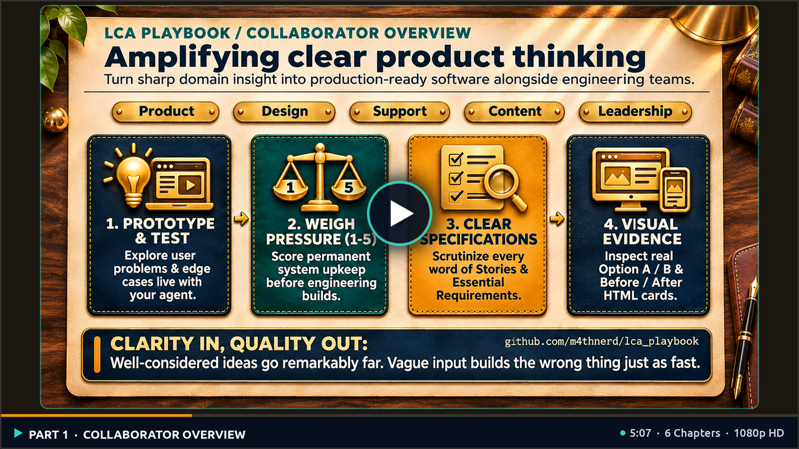](https://m4thnerd.github.io/lca_playbook/#collaborator-overview)<br>**[1. Collaborator Overview (`5:07`)](https://m4thnerd.github.io/lca_playbook/#collaborator-overview)** - Prototyping with an agent, Architecture Pressure `1-5`, User Stories & Essential Requirements, and visual HTML cards. | [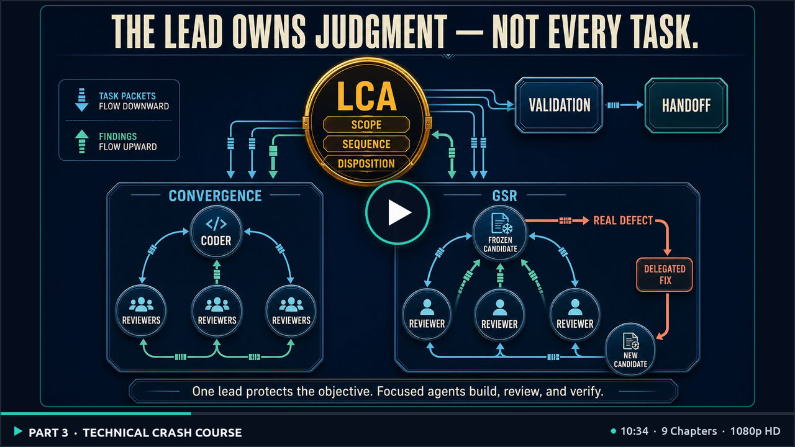](https://m4thnerd.github.io/lca_playbook/#engineer-deep-dive)<br>**[3. Technical Crash Course (`10:34`)](https://m4thnerd.github.io/lca_playbook/#engineer-deep-dive)** - `Bound -> Converge -> Stabilize`, 3 preflights, `convergence-review`, `general-stability-review`, UX loops, and 3-step setup. |
| [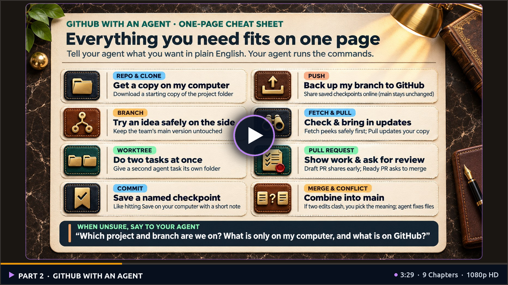](https://m4thnerd.github.io/lca_playbook/#github-with-an-agent)<br>**[2. GitHub with an Agent (`3:29`)](https://m4thnerd.github.io/lca_playbook/#github-with-an-agent)** - Zero terminal commands: branches, commits, Draft PRs, and merge conflicts on one calm cheat sheet. | [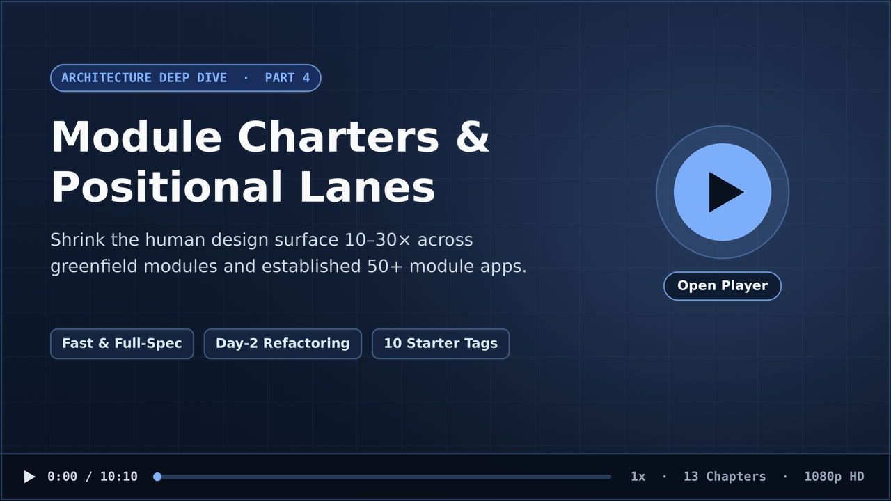](https://m4thnerd.github.io/lca_playbook/#module-charters-deep-dive)<br>**[4. Module Charters & Positional Lanes (`10:10`)](https://m4thnerd.github.io/lca_playbook/#module-charters-deep-dive)** - `Fast` & `Full-Spec` lanes, Day-2 evolution, `50+` module strangler retrofits, and `10` starter Hazard Tags. |

---

## Why Teams Use the LCA Playbook

1. **Shrink the human design surface 10x-30x without losing architectural grip.**
   [Module Charters](architecture/module_charters.md), four positional lanes
   (**Critical**, **Careful**, **Full-Spec**, and **Fast**), and sparse
   [hazard annotations](architecture/module_charter_annotations.md) separate
   what must be specified and guarded by humans from incidental implementation
   choices agents can own safely.
2. **Price Architecture Pressure before coding (1-5).** Agents score the
   *permanent maintenance surface* a story leaves behind
   ([Architecture Pressure Scoring](requirements/architecture_pressure_scoring.md))
   so teams weigh whether an idea warrants **Pressure 4-5** system-owner buy-in
   or whether a **Pressure 2** design delivers nearly the same value cleanly.
3. **High skill ceiling: quality in, quality out.** Humans scrutinize every word
   of plain-language User Stories and 1-10 **Essential Requirements** on a
   noise-free specification surface, backed by battle-tested preflights,
   local [operating conditions](example-case-studies/operating-conditions/lean-saas-team.md),
   and real failure case studies that cut weekly bloat cleanup from `~40%` down
   to `~6%`.
4. **Converge and stabilize with independent models.**
   [`convergence-review`](tools/convergence-review/README.md) runs an isolated
   coder + multi-reviewer loop (`core` + `architecture` critic) against the
   Essential Requirements, followed by independent
   [General Stability Review (GSR)](reviews/general_stability_review_playbook.md),
   [Staff Engineer Review](reviewers/staff_engineer_reviewer.md), and targeted
   human inspection on deep architectural changes.

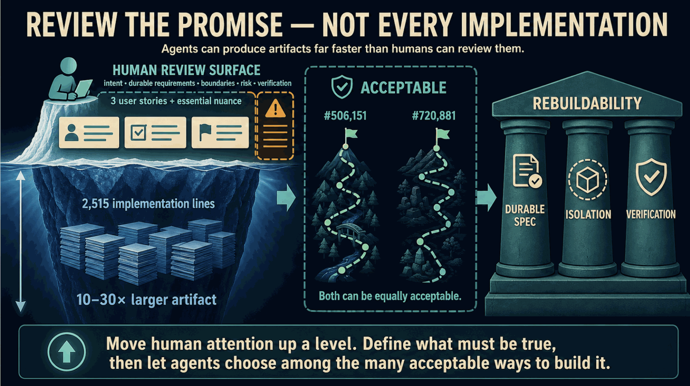

---

## How Product, Domain, and Engineering Roles Collaborate

In organizations where engineers, product managers, designers, support leads,
and domain experts all work with AI agents, non-engineers do not toss half-baked
ideas over the wall. By thinking deeply through the user problem and its edge
cases alongside their own agent, anyone can shape and test a working prototype
and check its **Architecture Pressure** (`1` low to `5` high: how much permanent
maintenance complexity the idea leaves behind, unpacked right below) *before*
spending an hour of engineering meeting time:

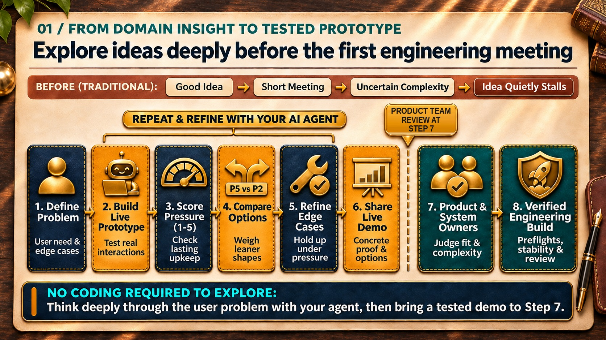

**Architecture Pressure (1-5)** measures what the system must carry forever
afterward, never how fast an agent writes the first draft. **Pressure 4 or 5 is
not forbidden** - core roadmap capabilities legitimately earn it when backed by
explicit system-owner buy-in and senior architectural design. Scoring early
simply ensures teams never pay Pressure 5 *accidentally* when a Pressure 2 edge
component delivers 95% of the user value at a fraction of the lasting surface:

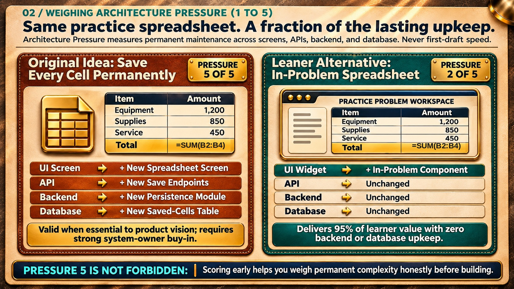

> **New to GitHub, user stories, or how web apps run?** See the optional, plain-English visual primers in **[Collaborator Foundations (`docs/collaborator-foundations/`)](docs/collaborator-foundations/README.md)** - starting with **[GitHub with an Agent](docs/collaborator-foundations/github-with-an-agent.md)**, plus supplementary guides on [shaping rough ideas into user stories](docs/collaborator-foundations/shaping-ideas-into-user-stories.md) and [solo-builder infrastructure basics](docs/collaborator-foundations/infrastructure-with-an-agent.md).

---

## Essential Requirements: High-Leverage Human Specifications

Design documents legitimately mix rationale, implementation notes, edge cases,
and non-goals. If a human has to wade through internal class names and migration
plumbing to tell what an agent is actually promising to build, subtle product
mistakes hide in plain sight; if reviewers guess what matters, different models
pull the code in incompatible directions.

Every LCA design doc therefore ends with `# Essential Requirements`: **1 to 10
short, plain-language bullets** stating only the behavioral promises and
boundaries whose absence would make the branch materially wrong. Keeping this
list compact is not about skimming quickly - stripping out implementation noise
is what lets you scrutinize **every single word** of the contract.

### What Humans Need to Know

- **Every word carries high leverage (1-10 bullets max):** A single loose phrase
  can send multi-agent loops down the wrong path; a focused 1-2 goal change
  should have 1-2 crisp bullets, never 8 padded ones.
- **Every bullet shows *why* it exists:** `[US-1]` links to an approved user
  story; narrow exception tags (`[Data Integrity]`, `[Security/Privacy]`,
  `[Maintainability]`, `[Reliability]`, `[Performance]`) require explicit
  upstream justification and may never introduce unrequested refusal gates,
  modes, or state machines.
- **Outcomes, not internal variable names or math dumps:** Detailed formulas,
  field names, and migration steps belong in the design doc's *Proposed
  Approach* for coders, not in the human specification anchor.
- **Provenance is explicit:** Beneath `# Essential Requirements`, every doc
  declares `ER Sign-Off Status: Human-Approved` or `ER Sign-Off Status:
  Agent-Drafted (Unreviewed)` (linked to a
  [Verbatim Human Intent Reference](requirements/verbatim_human_intent_reference_playbook.md))
  so downstream critics strip unrequested agent scope immediately.

### Real Before / After Example (`self_service_course_reset`)

**Bad (bloated, jargony, buries product behavior under internal mechanics):**
> - Authenticated users must be able to reset all practice progress for a single enrolled course they have access to, initiated from their Account page and confirmed via a dialog before the destructive action executes.
> - The confirmation dialog must be explicit that the action is destructive and irreversible, and must clearly distinguish it from score-submission-based preservation...
> - The reset path must reuse the existing single-course reset helper; this deliverable must not introduce new destructive data logic, new models, or migrations.
> - Self-service reset must not create any score-associated record (no `FormalAssessmentRecord`, no denormalized snapshot)... *(+3 more defensive hygiene bullets)*

**Good (focused behavioral contract - every word earns its place):**
> - `[US-1]` Authenticated users must be able to reset all practice progress for a single enrolled course they have access to, initiated from their Account page and confirmed via a dialog before the action executes.
> - `[US-1]` The confirmation dialog must be explicit that the action cannot be undone.
> - `[US-2]` Every successful reset must emit an activity-log entry distinct from score-submission events so downstream coaching history can see the reset.

*(For agents drafting ERs, see the [ER Drafting Reference](requirements/convergence_review_essential_requirements.md) and real production rewrites in [`example-case-studies/requirements-language-clarity/`](example-case-studies/requirements-language-clarity/).)*

---

## Start Here & Minimum Working Loop

New to the playbook? Read in this order:

1. [Quickstart](docs/start-here/quickstart.md)
2. [Mental Model (`Bound -> Converge -> Stabilize`)](docs/start-here/mental-model.md)
3. [Choosing a Workflow](docs/start-here/choosing-a-workflow.md)
4. [Full LCA Orchestration Playbook (`lca_playbook.md`)](lca_playbook.md)

The standard slice loop:

1. Capture human intent ([Verbatim Human Intent Reference](requirements/verbatim_human_intent_reference_playbook.md)) and user stories.
2. Run **User-Story Preflight** ([scoring guide](requirements/user_story_preflight_scoring.md); plus [Agentic PM Preflight](requirements/agentic_pm_user_story_preflight.md) when AI agents are workflow participants).
3. Draft 1-10 `# Essential Requirements` and run **ER Scoring Preflight** + **ER Justification Preflight** in parallel.
4. Implement and converge via [`convergence-review`](tools/convergence-review/README.md).
5. Run tests, [smoke tests](testing/smoke_testing.md), [General Stability Review](reviews/general_stability_review_playbook.md), and [Staff Engineer Review](reviewers/staff_engineer_reviewer.md), plus human code inspection on deep architectural seams when adding major machinery.
6. Report implementation, validation, review, and deployment proof as distinct states (with a visual HTML report via [`ui_review_format.md`](uiux/ui_review_format.md) whenever UI changes).

> **Why Operating Conditions & Case Studies Matter (`~40% -> ~6%` Bloat Cleanup):**
> Without explicit operating context, capable coding agents default to hyperscale assumptions - turning a simple internal admin grant form into 45 minutes and thousands of lines of airline-grade split-second concurrency locks on a site where only one admin logs in five minutes a day, or inflating a one-line `cache.delete()` under `[Reliability]` into a 650-line two-phase database state machine. Grounding reviewers in your real [`operating-conditions.md`](example-case-studies/operating-conditions/lean-saas-team.md) and [`example-case-studies/`](example-case-studies/README.md) eliminates most speculative over-engineering before it lands.

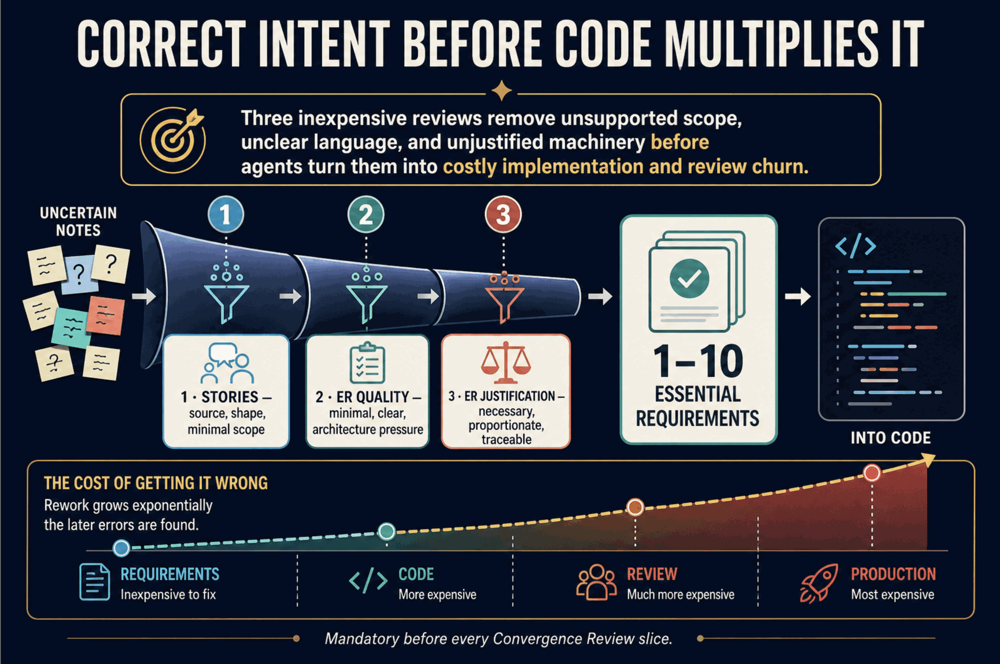

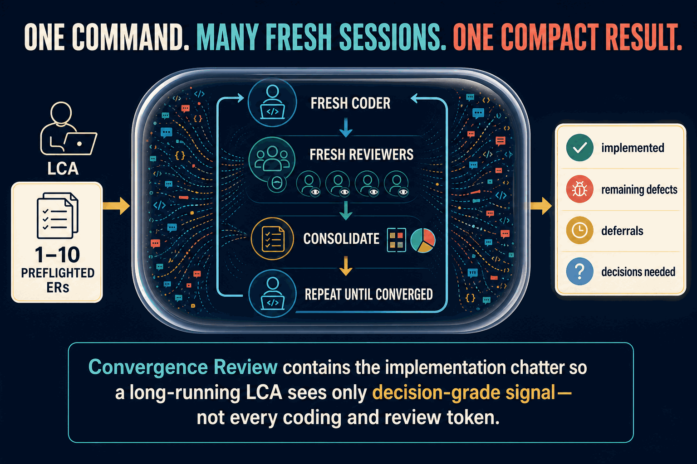

---

## Architecture: Module Charters, Positional Lanes & Hazard Tags

Where preflights, `convergence-review`, and GSR make individual pull requests
reliable, **[Module Charters](architecture/module_charters.md)** structure the
codebase so human understanding and Day-2 refactoring speed scale together.

Without a Charter, neither an unfamiliar engineer nor an AI agent knows which
behaviors inside thousands of lines of code are load-bearing promises versus
historical accidents - so agents treat every legacy quirk as sacred and pile
awkward exceptions on top. Promoting durable User Stories, Durable Requirements,
and External Contracts into a concise `CHARTER.md` (`2-6` pages at the module's
front door) shrinks the human design surface `10x-30x`: future enhancements
start by refining or adding a couple of stories, and agents can refactor
internals cleanly because anything outside the Charter is fair game to simplify.

### Choosing Among the Four Positional Lanes

Lanes apply to **specific architectural positions**, never as a blanket label on
an entire feature. Whenever you build something new or revisit an active area,
ask first whether it fits **Fast** or **Full-Spec** before settling for the
default **Careful** posture:

- **Fast Lane (`fast_lane/`, internal velocity & rapid iteration):** Built for
  internal operations dashboards, admin/support/content consoles, and workflow
  prototypes where shipping a working capability *today* and iterating on real
  team feedback matters far more than polished external visuals. Enforced by a
  one-way CI import valve so nothing outside `fast_lane/` imports it (the
  deletion test). **Can a Fast lane own database tables? Yes** - when the model
  docstring explicitly declares the table for rapid prototyping
  (`Expendable-data: ...` with no promise of data preservation or migration across
  iterations, warning teammates not to build permanent scaffolding on top while
  keeping authorization at `Careful` rigor).
- **Full-Spec Lane (`full_spec/`, core capabilities rebuildable from spec;
  *formerly called Rebuildable Lane*):** Powers production responsibilities that
  external callers depend on through one narrow public entry point (`1-4`
  exported symbols, deep imports blocked by CI). Business importance never
  disqualifies Full-Spec: **if an edge case, failure mode, or invariant matters,
  put it directly into `Durable Requirements` and the protected contract suite**
  so nothing important stays unwritten
  ([Full-Spec Lane Guide](architecture/module_charters_full_spec_lane.md)).
- **Careful Lane (unannotated holding default) & Retrofitting `50+` Module
  Codebases:** Unannotated files default to `Careful` when ownership and
  consumers are not isolated yet. In established codebases with `50+` modules,
  you never freeze roadmap work for a documentation campaign; instead, extract
  cohesive `full_spec/` clusters strangler-style when active feature work
  touches a clean seam (and skip artificial splits when real hazards remain in
  an outer shell; see the [Snapshot Boundary Case Study](example-case-studies/full-spec-lane-judgment-calls/daily-snapshot-semantics-boundary.md)).
- **Critical Lane (`Charter-lane: Critical` file header):** Reserved for genuine
  cross-module technical hazards - denormalized state, cache-commit ordering,
  security trust boundaries, or tight hot paths - requiring surgical minimal
  diffs and close line-by-line human review.

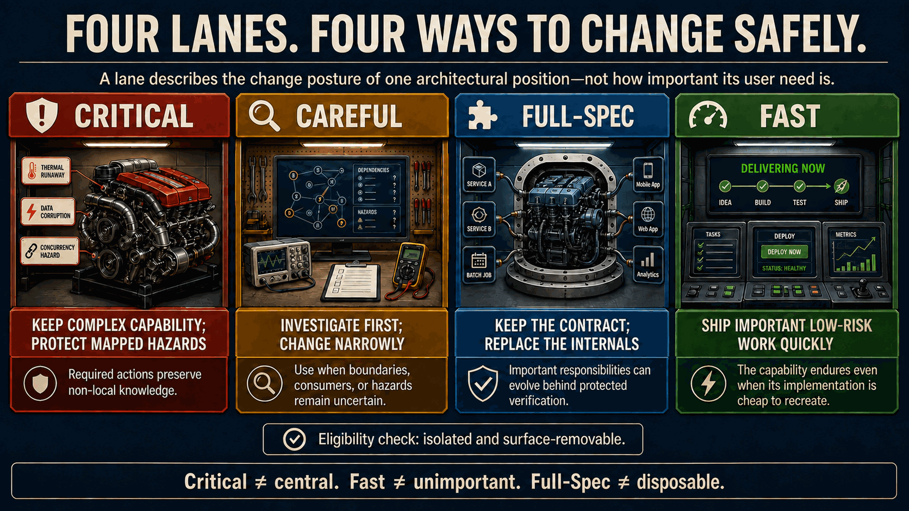

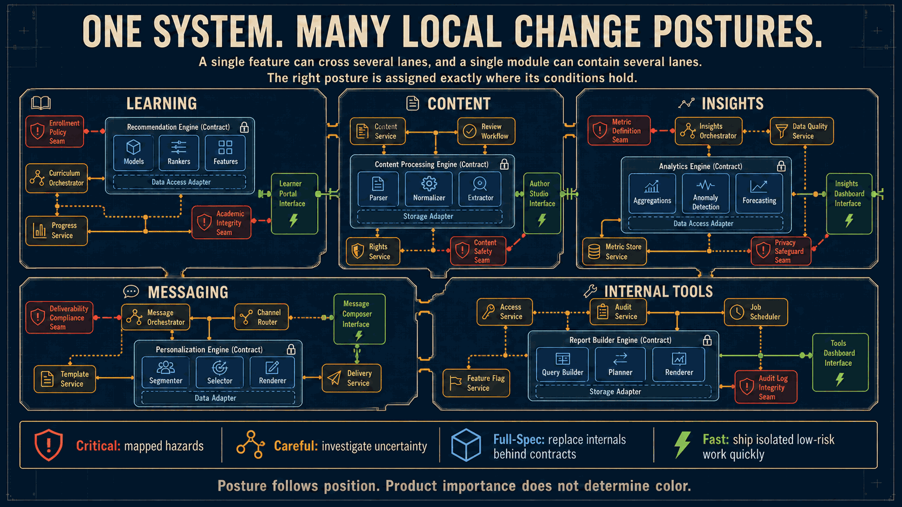

### Sparse Hazard Tags (`10` Starter Tags Included)

Some functions look ordinary locally yet hide non-local traps an engineer or AI
agent cannot deduce from that file alone. **[Module Charter Annotations](architecture/module_charter_annotations.md)**
includes **10 starter hazard tags** you can adopt on day one and customize in
your repo's own taxonomy (`sole-write-path`, `order-dependent`, `at-most-once`,
`trust-boundary`, `hot-path`, `denormalized-with-resync`,
`persisted-shape-contract`, `calibrated-values`, `external-api-contract`, and
`pii-egress`), pairing each sparse docstring marker with a concrete required
mitigation action.

Need rapid ground-truth visual posters of an unfamiliar or evolving codebase?
See **[Engineer Architecture Visuals](visualizations/engineer_architecture_visuals.md)**
for generating code-verified backend, frontend, full-stack, and system-boundary
infographic posters color-coded by lane.

---

## Assurance, UI/UX Loops, and Autonomous Leadership

### General Stability Review (GSR) & Full-Stack Checks
- [General Stability Review Playbook](reviews/general_stability_review_playbook.md)
  & [Staff Engineer Reviewer](reviewers/staff_engineer_reviewer.md)
- [Full-Stack Data Shape & Field-Existence Review](reviews/full_stack_data_shape_review.md)
- [Smoke Testing Guide](testing/smoke_testing.md)

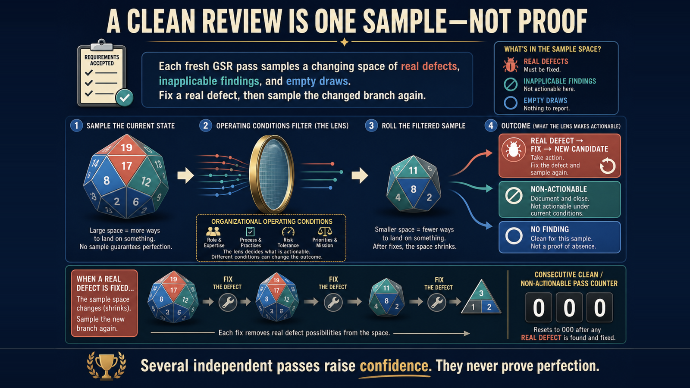

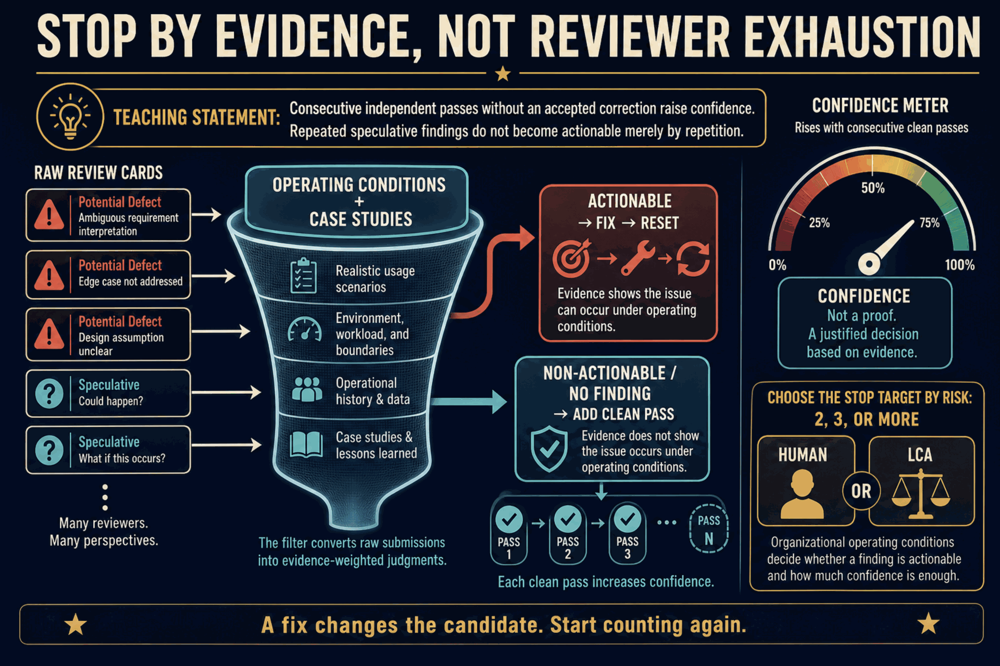

### UI/UX Design, Review, and Visual Decision Pages
- [Standing UI/UX Design Patterns (`DP-001`, `DP-002`)](uiux/ui_ux_design_patterns.md)
- [UI Review Format (`build_review_page.py` static HTML decision cards)](uiux/ui_review_format.md)
- [UI Screenshot Review Process (with anti-anchoring visual QA rules)](uiux/ui_screenshot_review.md)
- [Optional UX Persona Review](uiux/ux_persona_review.md) & [Autonomous Persona Design Loop](uiux/autonomous_persona_design_loop.md)
- [Low-Risk UX Enhancements Loop](uiux/low_risk_ux_enhancements_loop.md) & [Ambitious UX Competition Loop](uiux/ambitious_ux_competition_loop.md)

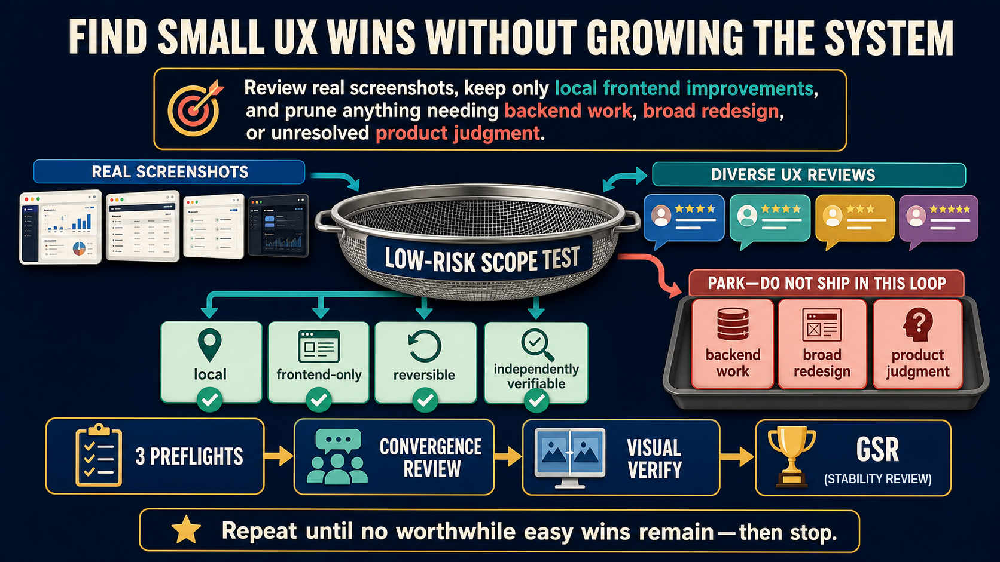

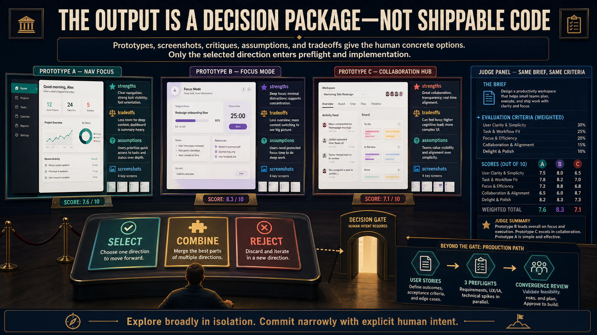

### Multi-Slice, Overnight, and Multi-Stream Coordination
- [Design Doc Slicing (Parent Doc + Sequence-Completable Slices)](requirements/design_doc_slicing.md)
- [Overnight LCA Playbook](lca_overnight_playbook.md)
- [Engineering Director Playbook](engineering_director_playbook.md)
- [Real De-Identified Case Studies (`example-case-studies/`)](example-case-studies/README.md)

---

## Install & Customize in 3 Steps

### Install the Optional Python CLIs (Python 3.10+)

Authentication stays in your existing agent CLIs (`claude`, `codex`, `agy`,
`grok`, `opencode`) - zero API keys live in this repository. Use editable (`-e`)
installs inside a virtual environment from your `lca_playbook` checkout so both
CLIs resolve `llm_config.py` and `reviewers/*.md` directly from the checkout:

```bash
cd /path/to/lca_playbook
python3 -m venv .venv
.venv/bin/pip install -e ./tools/convergence-review -e ./tools/general-stability-review
.venv/bin/convergence-review --help
.venv/bin/general-stability-review --help
```

To expose this playbook inside any product repository without committing it
(ensure `/local/` is in that repository's `.gitignore`):

```bash
mkdir -p /path/to/your-repo/local
ln -s /path/to/lca_playbook /path/to/your-repo/local/lca_playbook
```

### Customize for Your Setup (Zero Merge Conflicts)

1. **Pin your local CLI commands & models (`llm_config.py`, gitignored):**
   ```bash
   cp llm_config.example.py llm_config.py
   ```
   Edit `llm_config.py` to match your active subscriptions and preferred model
   tiers (if `llm_config.py` is absent, both CLIs fall back to
   [`llm_config.example.py`](llm_config.example.py) automatically).
2. **Define your team's Operating Conditions (`case-studies/local/operating-conditions.md`, gitignored):**
   Copy [`example-case-studies/operating-conditions/lean-saas-team.md`](example-case-studies/operating-conditions/lean-saas-team.md)
   to `case-studies/local/operating-conditions.md` and record your real team
   size, admin concurrency, and traffic scale so reviewers calibrate safeguards
   proportionately.
3. **Grow your private calibration library (`case-studies/local/`, gitignored):**
   Drop short post-mortems into `case-studies/local/` whenever an agent
   overbuilds or hits a domain trap (see [`case-studies/local/README.md`](case-studies/local/README.md)).
   - *Multiple personal machines?* Symlink `llm_config.py` and individual files
     under `case-studies/local/` into Syncthing, iCloud Drive, Dropbox, or
     Google Drive.
   - *Shared across an engineering team?* Track your team's operating conditions
     and case studies in `docs/lca/` inside your private product repo and
     symlink them into `case-studies/local/` (`ln -s ~/dev/your-repo/docs/lca/*.md case-studies/local/`).

---

## Status, Contributions, and License

This playbook is battle-tested daily in production agentic engineering and
shared openly in case it helps other builders and teams. See
[CONTRIBUTING.md](CONTRIBUTING.md) for guidelines on issues and pull requests
(while noting this is an actively used working methodology rather than a
staffed support product) and [GLOSSARY.md](GLOSSARY.md) for core terminology.

Licensed under the [Apache License, Version 2.0](LICENSE).
