# GitHub with an Agent

If you work in product, design, content, support, operations, leadership, or as a solo builder, Git and GitHub can feel intimidating at first.
You do not need to memorize `git` terminal commands to collaborate safely with an AI coding agent.
Your agent handles the mechanics of branches, commits, pushes, and pull requests on your behalf.
Your job is simply to keep track of *where your work lives* and *when it is ready for others to see or merge*.

Back to **[Collaborator Foundations (`docs/collaborator-foundations/`)](README.md)** | Related guides: **[Shaping Rough Ideas into User Stories](shaping-ideas-into-user-stories.md)** | **[Infrastructure with an Agent](infrastructure-with-an-agent.md)**

## Everything You Need on One Page

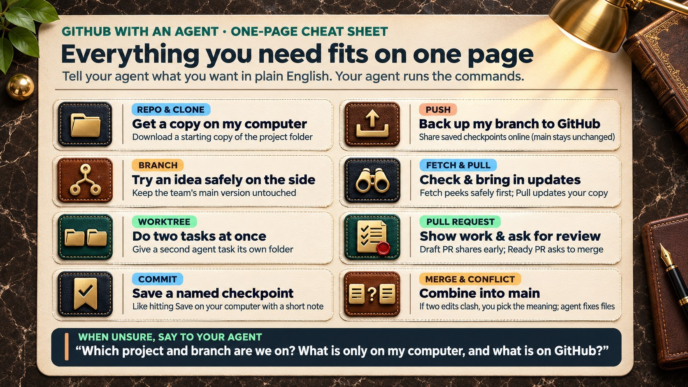

When you work alongside an AI agent, you never type a single Git command yourself: you describe what you want in plain English, and your agent handles the commands for you.

- **A repository (repo) is your project folder**, and **cloning** downloads a separate starting copy onto your computer (not a live shared screen, so teammates see nothing until you choose to share).
- **`main` is the team's shared official version**, while a **branch** is your own safe side copy where you can explore, test ideas, or throw rough drafts away without breaking `main`. (Working on one task at a time? Skip **worktrees** completely; only ask for a separate worktree when running two agents on two tasks at once.)
- **A commit is like hitting Save on your computer** with a short note (still private on your machine), and **pushing** backs up your branch to GitHub while leaving `main` untouched.
- **Fetch peeks safely** at what changed on GitHub without touching your files, and **pull** brings those updates into your copy when you are ready.
- **Opening a pull request (PR)** starts a friendly review page on GitHub (start with a **draft PR** to keep the Merge button locked while sharing early, then mark it **ready** to merge into `main` after approval; if a **merge conflict** ever comes up, nothing is broken: tell your agent in plain English which version you meant, and it fixes the files).

### Six Ready-to-Copy Starter Prompts

1. **Get a starting copy on your computer:**
   ```text
   Clone this repository so we can work on it: [link].
   ```
2. **Try an idea safely without touching `main`:**
   ```text
   Start a new branch for this idea and keep main unchanged.
   ```
3. **Save a checkpoint and back up your branch online:**
   ```text
   Save a commit for what we finished and push my branch to GitHub.
   ```
4. **Check for teammate updates safely before changing your files:**
   ```text
   Fetch the latest changes and tell me what is new before changing my files.
   ```
5. **Share early progress and request review when finished:**
   ```text
   Open a draft pull request so teammates can preview this, and mark it ready when we finish.
   ```
6. **Check your bearings anytime you feel unsure:**
   ```text
   Which project and branch are we on? What is only on my computer, and what is on GitHub?
   ```

---

## Quick Jump: All 10 Detailed Reference Cards (Optional Look-Ups)

You do not need to read all ten cards below in one sitting. Keep the single page above handy for everyday work, and jump to an individual card below only when you want a closer look at one specific topic.

1. [01. Where Does the Work Live?](#01-where-does-the-work-live)
2. [02. Repository vs Branch](#02-repository-vs-branch)
3. [03. Clone: Get Your Own Working Copy](#03-clone-get-your-own-working-copy)
4. [04. Workspace vs Worktree](#04-workspace-vs-worktree)
5. [05. Commit vs Push](#05-commit-vs-push)
6. [06. Fetch vs Pull](#06-fetch-vs-pull)
7. [07. Push vs Pull Request](#07-push-vs-pull-request)
8. [08. Draft PR vs Ready PR](#08-draft-pr-vs-ready-pr)
9. [09. Merge and Merge Conflict](#09-merge-and-merge-conflict)
10. [10. What Should I Ask the Agent?](#10-what-should-i-ask-the-agent)

---

## 01. Where Does the Work Live?

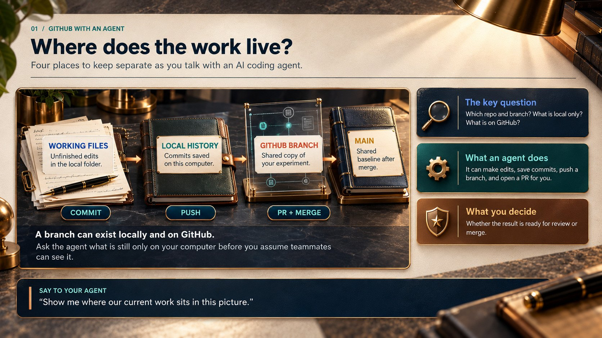

Work moves through four distinct places: unfinished edits in your project folder, saved checkpoints on your computer, a shared branch on GitHub, and `main` (the team's shared official version after merge). Always ask your agent what is still only on your computer before assuming teammates can see it.

**Say to your agent:**

```text
Show me where our current work sits in this picture.
```

---

## 02. Repository vs Branch

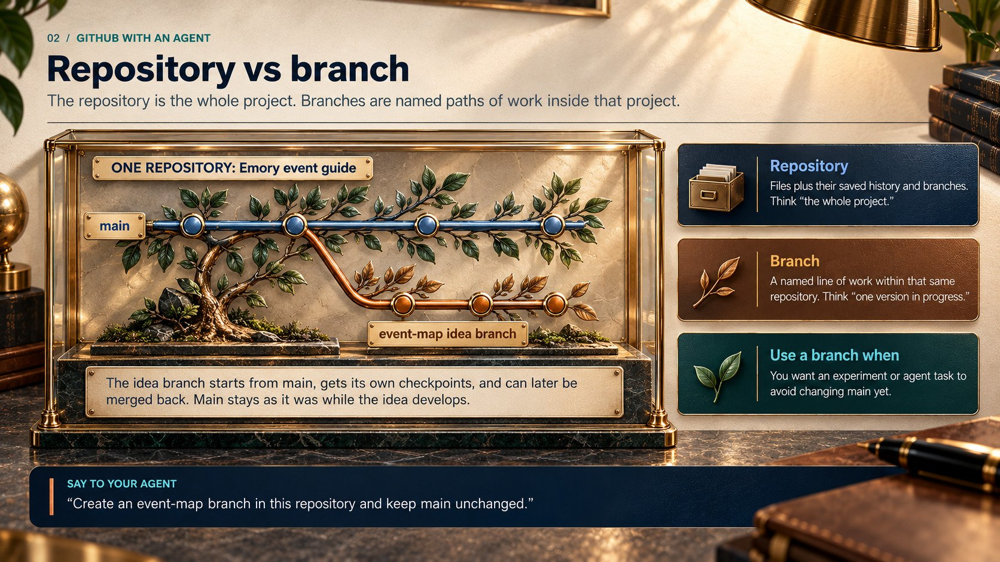

A repository is the whole project (all its files, history, and branches), while a branch is one named line of work in progress inside that project. Starting an experiment or agent task on its own branch lets you explore and save checkpoints freely while `main` stays untouched.

**Say to your agent:**

```text
Create an event-map branch in this repository and keep main unchanged.
```

---

## 03. Clone: Get Your Own Working Copy

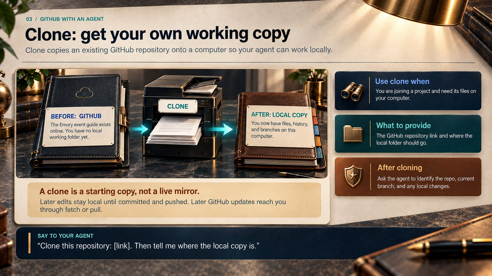

Cloning copies an existing GitHub repository onto your computer so you and your agent have a local folder to work in. A clone is a starting copy rather than a live mirror: your later edits stay local until committed and pushed, and teammates' online updates only arrive when you fetch or pull.

**Say to your agent:**

```text
Clone this repository: [link]. Then tell me where the local copy is.
```

---

## 04. Workspace vs Worktree

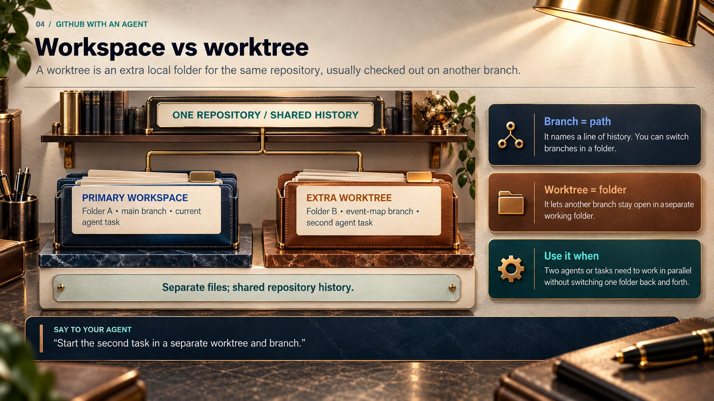

While a branch names a path of history, a worktree gives another branch its own separate folder on your computer backed by the same repository history. Use a separate worktree whenever two agent sessions or tasks need to run in parallel without overwriting or switching a single folder back and forth.

**Say to your agent:**

```text
Start the second task in a separate worktree and branch.
```

---

## 05. Commit vs Push

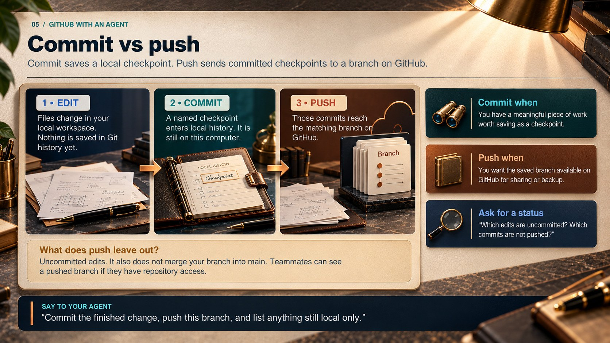

A commit saves a named checkpoint on your computer, while a push uploads your saved checkpoints to the matching branch on GitHub for backup or sharing. Pushing leaves uncommitted local file edits behind and does not merge your branch into `main`.

**Say to your agent:**

```text
Commit the finished change, push this branch, and list anything still local only.
```

---

## 06. Fetch vs Pull

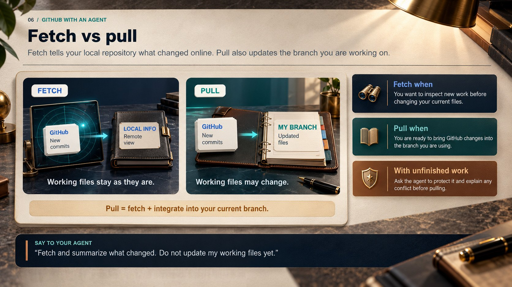

Fetching checks what changed on GitHub without touching your current working files, whereas pulling both fetches and integrates those online changes into the branch you are actively using. If you have unfinished local edits, ask your agent to fetch first so you can review what changed safely before updating your files.

**Say to your agent:**

```text
Fetch and summarize what changed. Do not update my working files yet.
```

---

## 07. Push vs Pull Request

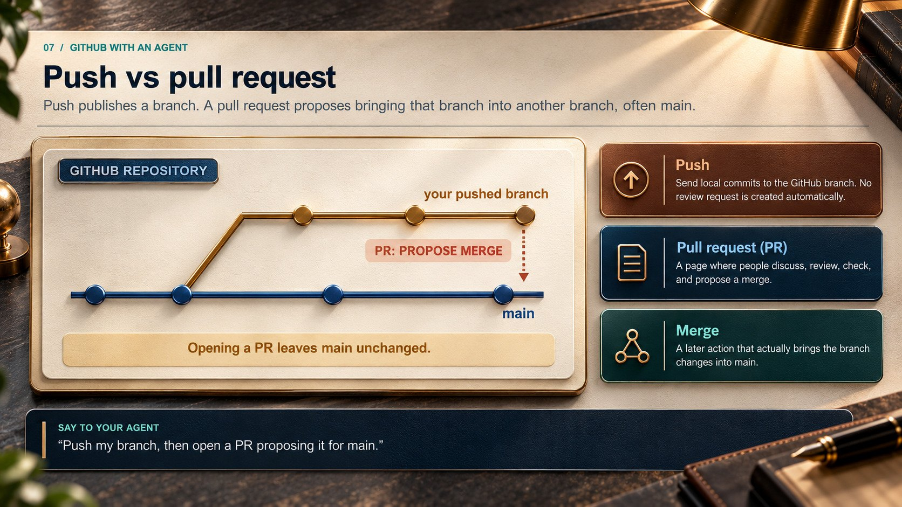

Pushing simply publishes your branch commits to GitHub, while opening a pull request (PR) creates a shared proposal page to discuss, review, and check those changes before bringing them into `main`. Opening a PR leaves `main` unchanged until someone explicitly merges it.

**Say to your agent:**

```text
Push my branch, then open a PR proposing it for main.
```

---

## 08. Draft PR vs Ready PR

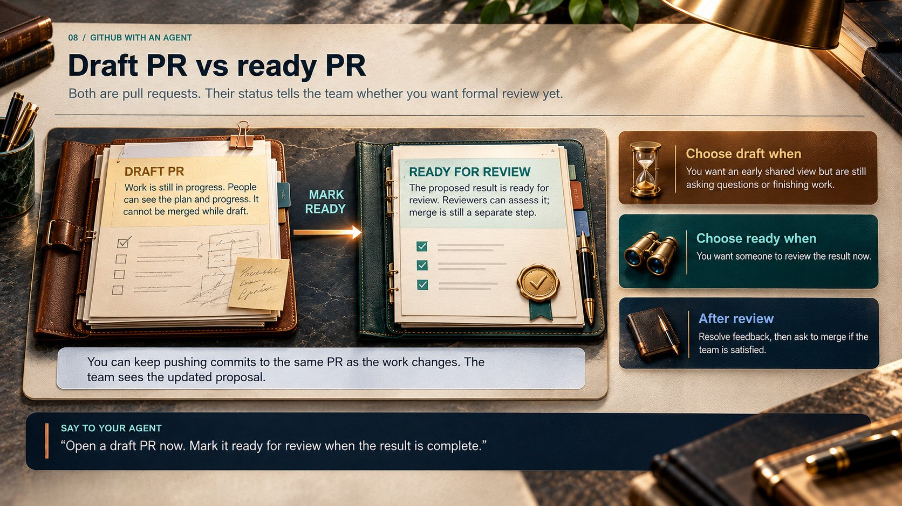

Both draft and ready pull requests share your progress on GitHub, and both update automatically as you push new commits to the branch. Open a draft PR when you want early visibility or feedback while work is still unfinished (it cannot be merged while in draft), and mark it ready when you want formal review.

**Say to your agent:**

```text
Open a draft PR now. Mark it ready for review when the result is complete.
```

---

## 09. Merge and Merge Conflict

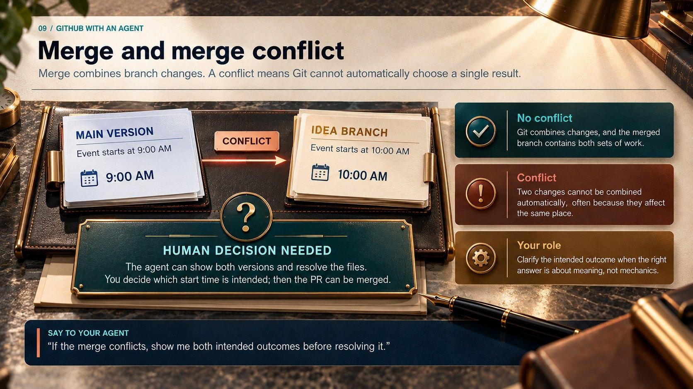

Merging combines your branch changes into the target branch, and a merge conflict simply means two branches edited the same spot in ways Git cannot automatically choose between. Your agent can handle the file mechanics, while you make the human decision about which business outcome was actually intended.

**Say to your agent:**

```text
If the merge conflicts, show me both intended outcomes before resolving it.
```

---

## 10. What Should I Ask the Agent?

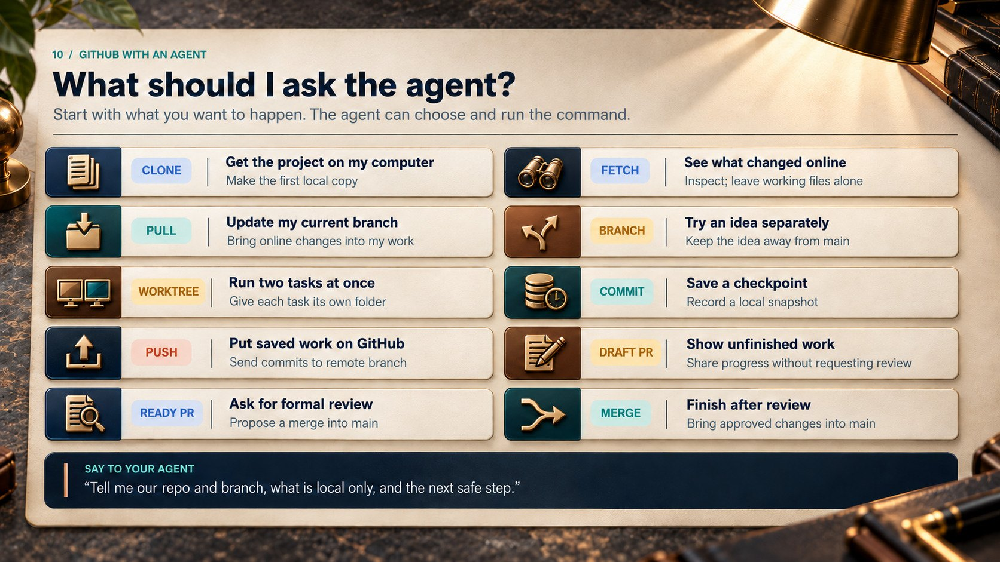

Whenever you feel unsure about Git state, describe the outcome you want in plain English instead of guessing a command name. Ask your agent to state which repository and branch you are on, what is still local only, and what the safest next step is before changing shared work.

**Say to your agent:**

```text
Tell me our repo and branch, what is local only, and the next safe step.
```
