# Infrastructure with an Agent

Fourteen plain-English visual cards explaining what happens after code is written: local laptop previews, where an AI agent actually runs commands, application layers, architecture pressure, cloud servers, deployments, domains, security boundaries, backups, and monthly hosting bills.

> [!IMPORTANT]
> **Who should run these prompts vs. read this guide as background vocabulary?**
> - **Independent solo builders, non-technical founders, and hobbyists** building a standalone project on your own personal cloud account: you can use these cards and prompts directly with your coding agent to go from a local laptop preview to a live, backed-up, cost-monitored web app.
> - **Collaborators inside an established company or engineering team:** treat this guide strictly as **shared mental models and vocabulary** so terms like *localhost*, *staging*, *DNS*, *CI checks*, and *architecture pressure* are never mysterious. **Never** spin up cloud servers, connect domains, or deploy apps outside your organization's IT, security, and engineering policies.

**Why these cards name AWS and Django:** Beginners learn faster from concrete nouns than from abstract placeholders, so the illustrations show cloud hosting with **AWS (`EC2`, `Route 53`)** and web apps with **Python (`Django`)**. Neither is required by the LCA Playbook: the exact same mental models apply on Google Cloud (`Compute Engine`, `Cloud DNS`), Microsoft Azure (`Virtual Machines`, `Azure DNS`), managed app platforms (`Render`, `Fly.io`, `Railway`), or web stacks like `Next.js`, `Rails`, or `FastAPI`. Whenever you build on your own stack, ask your agent to translate the concrete nouns on the card to the tools you actually use.

Back to **[Collaborator Foundations (`docs/collaborator-foundations/`)](README.md)** | Related guides: **[GitHub with an Agent](github-with-an-agent.md)** | **[Shaping Rough Ideas into User Stories](shaping-ideas-into-user-stories.md)**

## Quick Jump: All 14 Cards

1. [01. Code, a Running App, and an Agent](#01-code-a-running-app-and-an-agent)
2. [02. Yes, Your Laptop Can Run a Website](#02-yes-your-laptop-can-run-a-website)
3. [03. Where Is the Agent Doing the Work?](#03-where-is-the-agent-doing-the-work)
4. [04. Choose a Familiar Set of Building Blocks](#04-choose-a-familiar-set-of-building-blocks)
5. [05. Every App Has Three Kinds of Responsibility](#05-every-app-has-three-kinds-of-responsibility)
6. [06. How Much Complexity Will This Leave Behind?](#06-how-much-complexity-will-this-leave-behind)
7. [07. Same App. Different Places to Try It.](#07-same-app-different-places-to-try-it)
8. [08. EC2 Is a Computer You Rent from AWS](#08-ec2-is-a-computer-you-rent-from-aws)
9. [09. Deploy Means Put a Version into Service](#09-deploy-means-put-a-version-into-service)
10. [10. Should Main Updates Go Live Automatically?](#10-should-main-updates-go-live-automatically)
11. [11. Your Domain Is the Address. DNS Finds the Server.](#11-your-domain-is-the-address-dns-finds-the-server)
12. [12. Give Each Door the Right Key](#12-give-each-door-the-right-key)
13. [13. A Live App Needs a Care Plan](#13-a-live-app-needs-a-care-plan)
14. [14. Make the Monthly Bill Part of the Design](#14-make-the-monthly-bill-part-of-the-design)

---

## 01. Code, a Running App, and an Agent

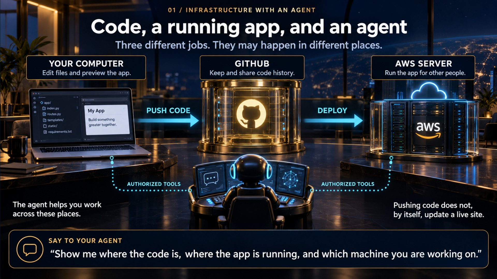

Editing files on your laptop, saving version history on GitHub, and running a live website on a server are three separate jobs that often happen on different machines. Your coding agent is not the web server itself: it uses authorized tools to help you work across those places, and pushing code to GitHub does not automatically update a live site unless a deployment step runs.

**Say to your agent:**

```text
Show me where the code is, where the app is running, and which machine you are working on.
```

---

## 02. Yes, Your Laptop Can Run a Website

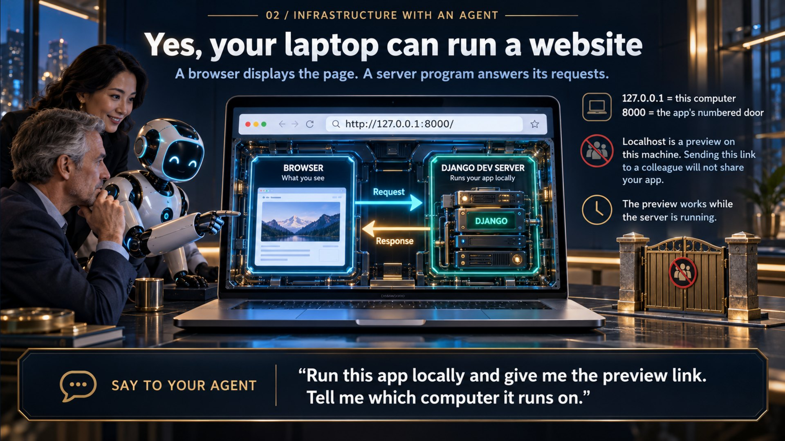

When you open an address like `http://127.0.0.1:8000/` (also called `localhost`), your web browser is talking to a small development server running right inside your own computer on port `8000`. That preview only works on your machine while the local server program stays running, so pasting a `127.0.0.1` or `localhost` link to a teammate will not share your app.

**Say to your agent:**

```text
Run this app locally and give me the preview link. Tell me which computer it runs on.
```

---

## 03. Where Is the Agent Doing the Work?

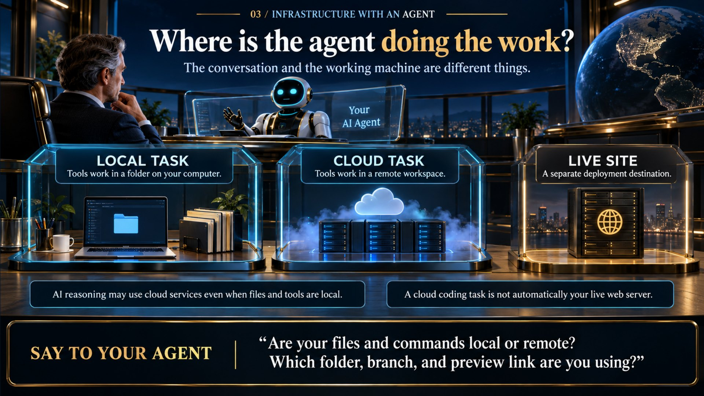

Even though an AI model's reasoning usually happens in the cloud, the files it edits and the commands it runs live either in a local folder on your computer or inside a temporary remote workspace. Neither workspace is automatically your public production website, so always confirm where your agent's edits and preview server actually live.

**Say to your agent:**

```text
Are your files and commands local or remote? Which folder, branch, and preview link are you using?
```

---

## 04. Choose a Familiar Set of Building Blocks

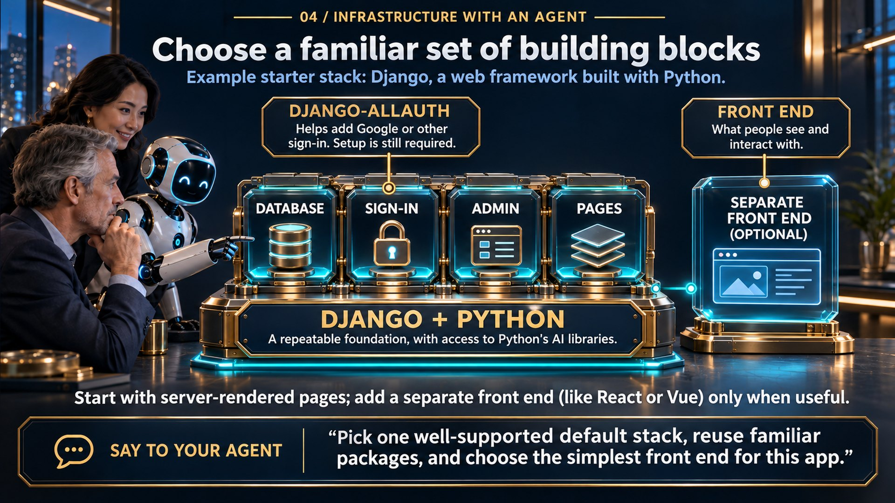

Well-established frameworks (such as Python's Django) bundle repeatable pieces for databases, user sign-in, admin screens, and server-rendered web pages so your agent does not invent fragile custom plumbing from scratch. Start with straightforward server-rendered pages and trusted sign-in libraries, adding a separate front-end framework (like React or Vue) only when interactive UI needs genuinely call for it.

**Say to your agent:**

```text
Pick one well-supported default stack, reuse familiar packages, and choose the simplest front end for this app.
```

---

## 05. Every App Has Three Kinds of Responsibility

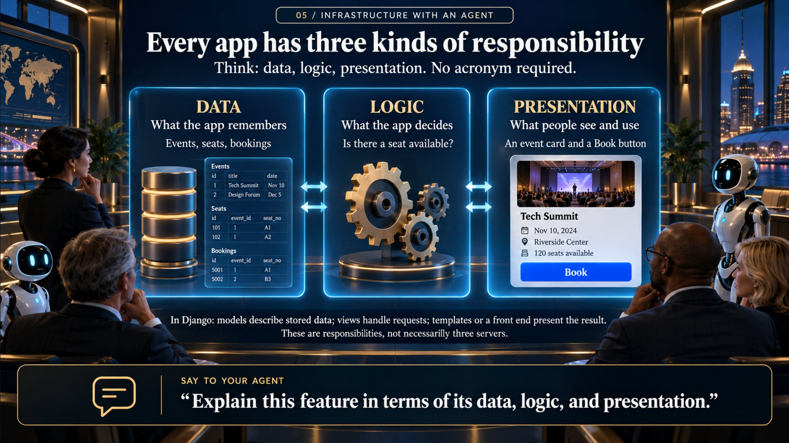

Almost every feature breaks down into three plain-English responsibilities: **data** (what the app remembers, like events and bookings), **logic** (what the app decides, like whether a seat is still open), and **presentation** (what people see and click). These describe distinct jobs in the code rather than a requirement to run three separate servers.

**Say to your agent:**

```text
Explain this feature in terms of its data, logic, and presentation.
```

---

## 06. How Much Complexity Will This Leave Behind?

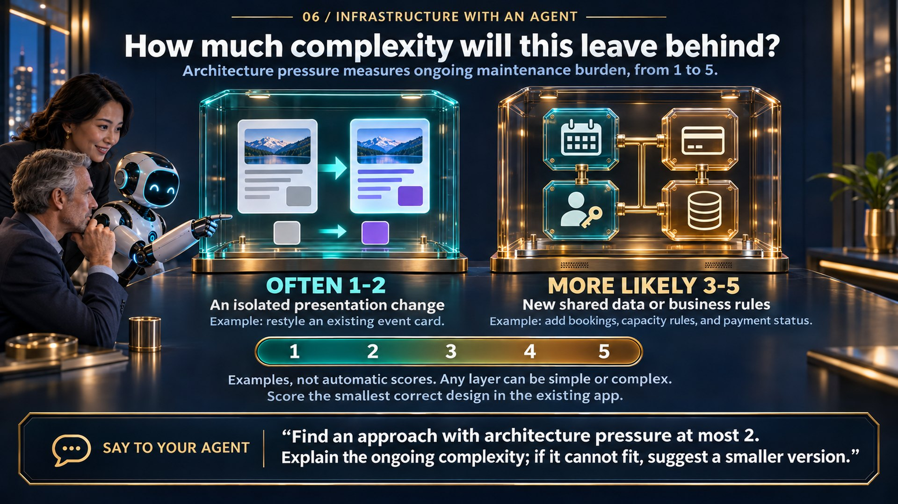

In the [LCA Playbook](../../requirements/architecture_pressure_scoring.md), **Architecture Pressure (1 to 5)** scores the permanent maintenance burden a change leaves behind after it ships, not how fast an agent can type the first draft. Restyling an isolated card often sits around Pressure 1-2, while introducing shared booking rules, permissions, and payment states often reaches Pressure 3-5 and deserves deliberate design or a smaller scoped version.

**Say to your agent:**

```text
Find an approach with architecture pressure at most 2. Explain the ongoing complexity; if it cannot fit, suggest a smaller version.
```

---

## 07. Same App. Different Places to Try It.

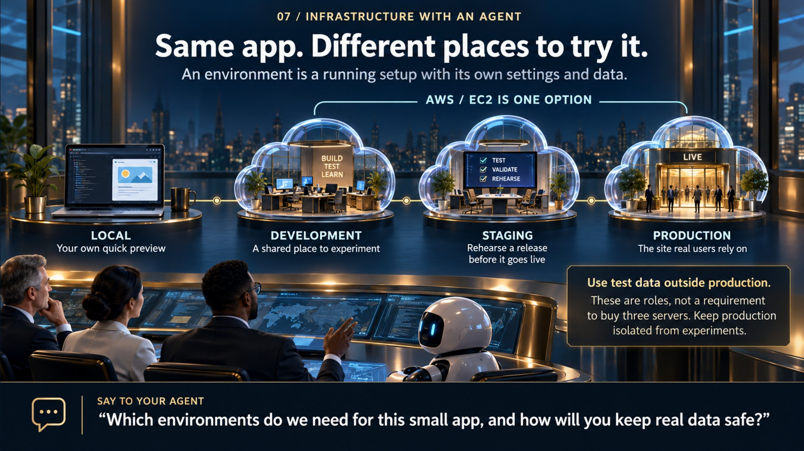

An **environment** (`local`, `development`, `staging`, or `production`) is simply a running copy of your app with its own settings and its own isolated database. Small solo projects rarely need four separate cloud servers, as long as experiments use safe test data and stay strictly separated from the live production environment that real users rely on.

**Say to your agent:**

```text
Which environments do we need for this small app, and how will you keep real data safe?
```

---

## 08. EC2 Is a Computer You Rent from AWS

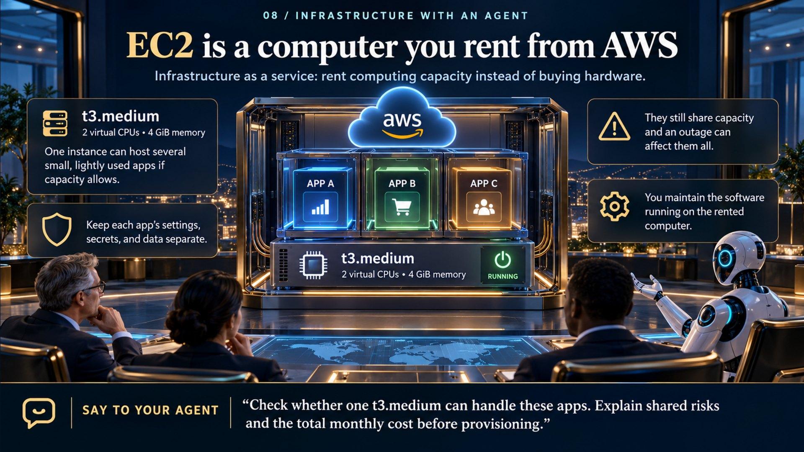

Services like AWS EC2 rent virtual computers by the hour or month instead of making you buy physical hardware, and a modest server (such as a `t3.medium`) can often run one or several lightly used solo apps. When apps share one virtual machine, keep their databases, settings, and secrets strictly separated, and remember that you (with your agent's help) remain responsible for maintaining the software on that server and accepting shared outage risk.

**Say to your agent:**

```text
Check whether one t3.medium can handle these apps. Explain shared risks and the total monthly cost before provisioning.
```

---

## 09. Deploy Means Put a Version into Service

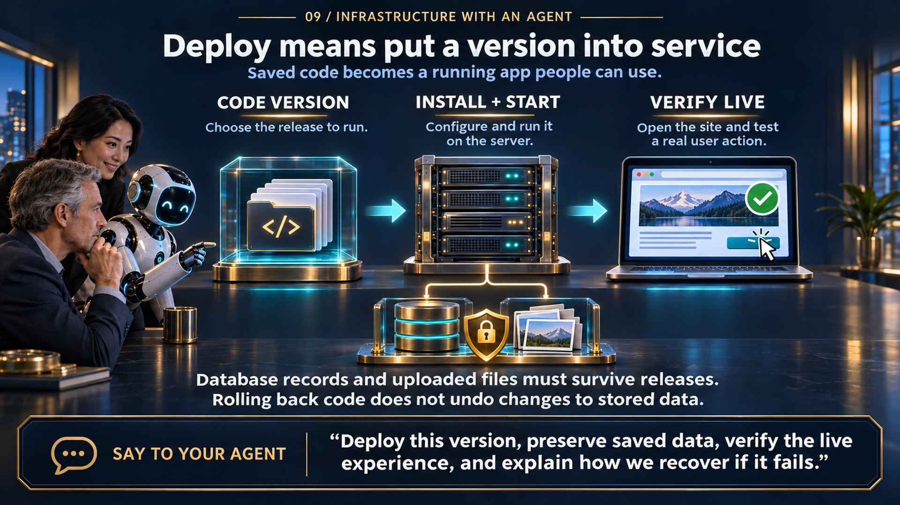

Deploying takes a specific saved version of your code, installs and starts it on a production-ready server, and verifies that real user actions work end to end. Because customer database records and uploaded files must outlive any single code release, rolling back code to an earlier version does not automatically undo changes already saved in your database.

**Say to your agent:**

```text
Deploy this version, preserve saved data, verify the live experience, and explain how we recover if it fails.
```

---

## 10. Should Main Updates Go Live Automatically?

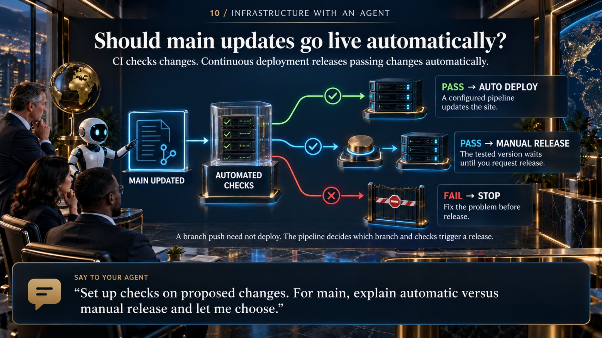

**Continuous Integration (CI)** runs automated checks on proposed code changes before they merge, stopping broken updates at the gate. Once changes merge to `main`, your pipeline can either deploy passing updates automatically (**continuous deployment**) or hold the tested release until a human clicks approve (**manual release**).

**Say to your agent:**

```text
Set up checks on proposed changes. For main, explain automatic versus manual release and let me choose.
```

---

## 11. Your Domain Is the Address. DNS Finds the Server.

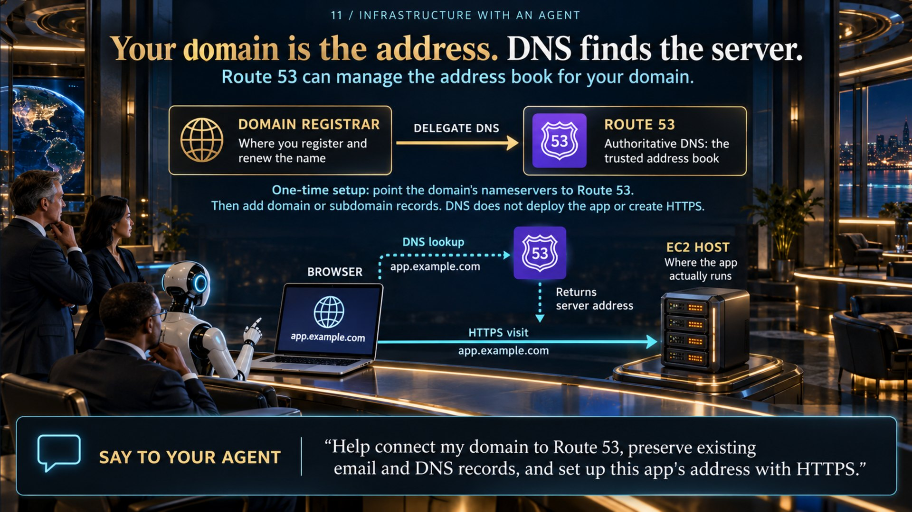

Your domain registrar records who owns a name like `example.com`, while **DNS** (such as AWS Route 53 or Cloudflare DNS) acts as the public address book telling browsers which server hosts `app.example.com`. Changing DNS nameservers or records does not deploy your app or enable HTTPS on its own, and any DNS update on an existing domain must carefully preserve existing email (`MX`/`TXT`) records.

**Say to your agent:**

```text
Help connect my domain to Route 53, preserve existing email and DNS records, and set up this app's address with HTTPS.
```

---

## 12. Give Each Door the Right Key

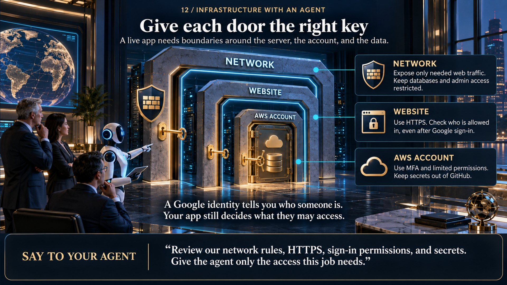

A public web app needs three distinct layers of protection: network rules that expose only web traffic while locking down databases, HTTPS plus app-level permission checks (since signing in with Google proves *who* someone is, not *what* they are allowed to open), and cloud-account hygiene (multi-factor authentication, least-privilege keys, and zero secrets committed to GitHub).

**Say to your agent:**

```text
Review our network rules, HTTPS, sign-in permissions, and secrets. Give the agent only the access this job needs.
```

---

## 13. A Live App Needs a Care Plan

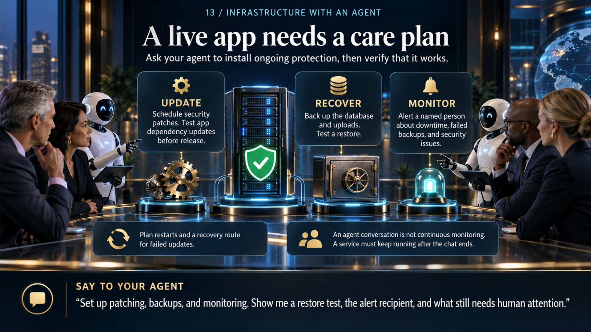

Launching an app is day one: staying online requires scheduled security patching, automated backups of both the database and user uploads (verified with a real restore test), and uptime/error alerts sent to a named human. An AI chat session stops watching the moment you close the window, so monitoring and backups must run as durable background services.

**Say to your agent:**

```text
Set up patching, backups, and monitoring. Show me a restore test, the alert recipient, and what still needs human attention.
```

---

## 14. Make the Monthly Bill Part of the Design

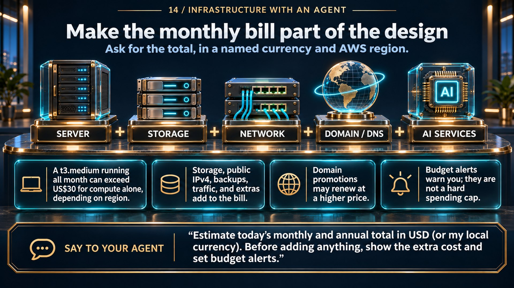

Cloud bills add up across compute hours, disk storage, public IPv4 addresses, backups, network traffic, domain renewals, and separate AI API usage. Ask your agent to estimate the full monthly and annual run rate in your preferred currency before provisioning anything, and turn on cloud budget alerts right away - keeping in mind that budget alerts send warning emails rather than enforcing a hard spending cutoff.

**Say to your agent:**

```text
Estimate today's monthly and annual total in USD (or my local currency). Before adding anything, show the extra cost and set budget alerts.
```
