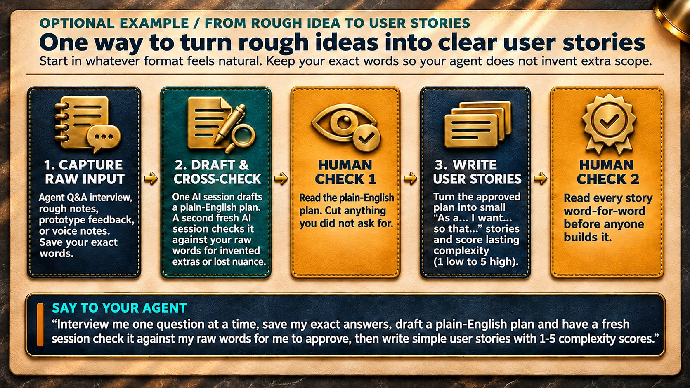

# Shaping Rough Ideas into User Stories

This optional, supplementary guide is for product managers, designers, subject-matter experts, founders, and solo builders working alongside AI coding agents.

There is **no single "official" way to come up with user stories**. Different situations call for very different starting points, and the right approach is whichever one helps you express what users actually need without adding extra ceremony:

1. **Small addition or tweak to an existing feature:** Write or edit 1-2 plain sentences (`"As a <who>, I want <what>, so that <why>"`) directly with your agent. No bigger process is needed.
2. **Interactive Q&A interview (often easiest when starting fresh):** Ask your agent to interview you one question at a time about who the user is, what problem they hit today, and what the simplest useful version looks like.
3. **Clickable prototype first:** Have your agent mock up a quick visual screen so you can click around and react to something concrete, then write user stories only for the parts you decide to keep.
4. **Unstructured brainstorm to structured stories (the visual example below):** Useful on larger 0-to-1 ideas when you have scattered notes, customer feedback, or a voice brainstorm and want two independent AI sessions to organize it without losing nuance.

Back to **[Collaborator Foundations (`docs/collaborator-foundations/`)](README.md)** | Related guides: **[GitHub with an Agent](github-with-an-agent.md)** | **[Infrastructure with an Agent](infrastructure-with-an-agent.md)**

---

## Why Saving Your Raw Original Words Matters

When you hand a rough idea to an AI agent, the agent tries hard to be helpful. Left on its own, it will often quietly fill in extra screens, settings, permissions, or edge-case rules that sound plausible on paper even though nobody asked for them. Teams sometimes call this **requirements risk**: building polished software for features you never actually wanted, and then having to maintain that extra complexity forever.

Two simple habits keep you in the driver's seat:

- **Keep your exact original words saved in a file.** Whether your raw input came from an interview transcript, rough bullet points, prototype reactions, or voice notes, saving those exact words gives a second, independent AI session a ground-truth reference so it can flag *"Wait, the human never asked for that"* or *"You dropped an important nuance they mentioned."*
- **Read every final user story word-for-word yourself.** You do not need to read source code to steer an AI coding agent well. Reading the plain-English plan and each `"As a... I want... so that..."` user story before anyone builds it is your steering wheel. Cut anything you do not recognize or do not need yet.

---

## Visual Example: From Rough Idea to Reviewed User Stories



You can use as much or as little of this flow as fits the size of your idea:

- **For a small or medium feature**, Step 1 (a quick Q&A interview) -> Human Check 1 (approving a short plain-English plan) -> Step 3 (drafting small user stories) -> Human Check 2 (reading every story word-for-word) is plenty.
- **For a larger, messier 0-to-1 idea**, adding Step 2 (having a second fresh AI session cross-check the drafted plan against your saved raw words) catches invented scope and lost context while changes still take thirty seconds of editing text. Asking your agent to score each story's lasting maintenance complexity (`1 low to 5 high`) also helps you spot unexpectedly heavy features early so you can simplify them before anyone writes code.

---

## Ready-to-Copy Prompts

### Option A: The Interactive Q&A Interview Path

Use this whenever you have an idea in your head and want your agent to draw it out one question at a time instead of staring at a blank page.

**Say to your agent:**

```text
Interview me one question at a time, save my exact answers, draft a plain-English plan and have a fresh session check it against my raw words for me to approve, then write simple user stories with 1-5 complexity scores.
```

If you want a slightly fuller version that also checks story size and complexity at the end:

```text
I have a rough product idea I want to shape into clear user stories.
1. Ask me one question at a time about who this is for, what problem they hit today, and what the simplest useful version looks like.
2. Save my exact answers word-for-word in a raw-notes file as we go.
3. Once I say you have enough context, summarize a short plain-English plan for me to check first. Do not invent extra settings, roles, or screens I did not ask for.
4. After I approve the plan, draft small "As a <who>, I want <what>, so that <why>" user stories with plain-English acceptance checks and a lasting complexity score (1 low to 5 high) for each story so I can read every word before we build anything.
```

---

### Option B: The Two-Session Cross-Check Path (For Larger Brainstorms)

Use this when you already have rough notes, prototype feedback, customer quotes, or a recorded brainstorm transcript saved in a file (for example, `raw-notes.md`), and you want two separate AI sessions (any two fresh sessions or two different frontier AI tools you have handy) to keep each other honest.

**Step 1 - Say to your drafting AI session:**

```text
Read my exact words in raw-notes.md without editing that file.
Organize what I asked for into a clear, plain-English plan (goals, what is in scope for a simple first version, and open questions for me).
Stay strictly faithful to raw-notes.md: do not invent extra features, dashboards, permissions, or rules I did not ask for. Whenever something is genuinely unclear, list it as a short question for me instead of guessing.
```

**Step 2 - Say to a second fresh, independent AI session:**

```text
Compare plan-draft.md against my original words in raw-notes.md.
Point out two things in plain English:
1. Anything added in plan-draft.md that I did not actually ask for in raw-notes.md (invented scope or unnecessary complexity).
2. Any important nuance, goal, or constraint from raw-notes.md that got lost or watered down in plan-draft.md.
```

**Step 3 - After you read the revised plan and cut anything extra, say to your agent:**

```text
Turn this approved plan into small, plain-English user stories ("As a <who>, I want <what>, so that <why>") with clear acceptance criteria and a lasting complexity score (1 low to 5 high) per story. Keep every story faithful to the approved plan so I can read each one word-for-word before implementation starts.
```

---

When your stories look right and you are ready to hand them to an engineer or run an implementation workflow, head back to **[Collaborator Foundations](README.md)** or the main **[LCA Playbook overview](../../README.md)**.
