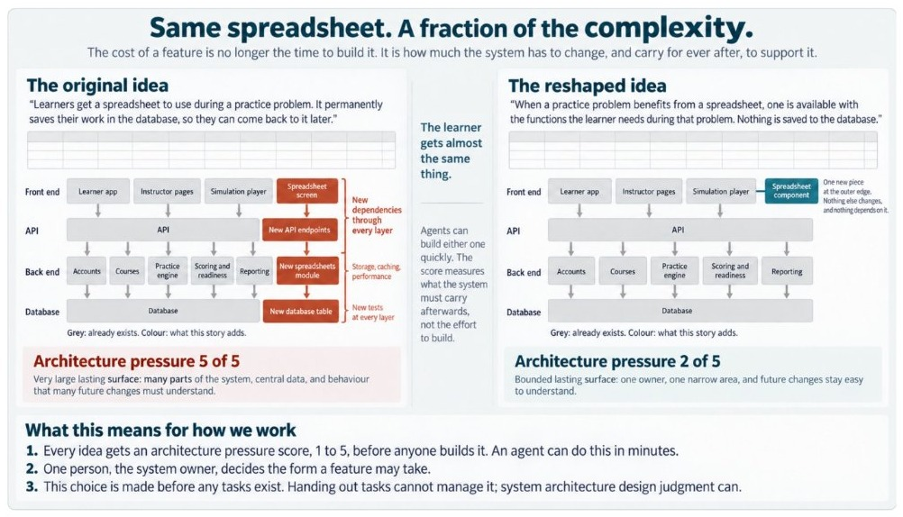

# Architecture Pressure Scoring

This guide defines the 1-5 Architecture Pressure rubric and its optional
code-aware impact-estimation pass.

Architecture Pressure is not a quality score. High pressure can be correct when
the value and system constraints justify it. The score exists to make coupling,
contract surface, and future maintenance burden visible before implementation.
It scores the long-term state the codebase will be in after the change lands,
not the short-term effort required to get there.

Architecture Pressure does not score implementation difficulty, transition
churn, rollout risk, migration effort, or the number of files touched while
making the change. Report those separately as Implementation/Transition Pressure
when useful.

## Core Question

> After the smallest correct implementation has landed, how much ongoing module,
> layer, coupling, data-contract, retained code/test, fixture, or consumer
> complexity does the resulting codebase retain, introduce, or remove?

Score the smallest correct implementation, not the largest plausible
implementation.

## Scoring Table

| Score | Meaning |
|---|---|
| 1 | Tiny durable surface. One clear owner, local behavior, no durable contract, no meaningful future coordination. |
| 2 | Bounded durable surface. One owner or narrow module area, modest retained code/test surface, limited contract semantics, and future changes remain locally understandable. |
| 3 | Moderate durable surface. Meaningful retained code, fixtures, schema, or contract behavior in one area, or a small number of consumers/modules that future changes must coordinate with. |
| 4 | Large durable surface. Substantial retained implementation or test surface, multiple modules/layers/consumers, durable contracts, compatibility paths, or semantics spread across important areas. |
| 5 | Very large durable surface. System-shaped retained burden: broad maintained code volume, many consumers/owners, central data or contract semantics, or behavior that many future changes must understand. |

Score the highest meaningful steady-state burden tier the change leaves behind,
not an average across all signals. A score should cite the concrete durable
anchors that justify it.

### Visual Intuition: Reshaping Pressure Before Coding

Agents can implement either version quickly; the score measures what the system
must carry forever afterward:



## Durable Pressure Anchors

Use concrete retained artifacts as calibration anchors:

- retained non-generated source code
- retained tests and fixtures that future changes must keep coherent
- durable DB schema, migrations that leave ongoing compatibility obligations, or
  changed data semantics
- public API, SPA payload, prompt, event, admin, or reporting contracts
- number of owning modules and downstream consumers that must understand the
  behavior
- compatibility paths that remain after the change lands
- duplicated or distributed business rules

Large retained code volume can raise steady-state pressure when that code is
hand-maintained product, domain, integration, prompt, fixture, or test logic.
Do not count transition churn, deleted code, generated code, or one-time
migration scaffolding unless it leaves behind durable behavior, compatibility,
or maintenance obligations.

## Module Lane Context

Use [module_charters.md](../architecture/module_charters.md) and
[module_charters_full_spec_lane.md](../architecture/module_charters_full_spec_lane.md)
as the governing philosophy for module-lane judgment.

The same rough LoC shape can carry different pressure depending on where it
lands:

- **Critical-lane** modules have many consumers or subtle domain behavior; even
  single-module changes can score high when they add complexity near critical
  models, contracts, denormalized state, or central reasoning paths.
- **Careful-lane** modules can absorb meaningful business behavior, but new
  durable state, configuration systems, or cross-module semantics should be
  scrutinized.
- **Full-Spec-lane** modules stay low pressure when changes fit cleanly inside
  the authoritative spec and thin contract, and jump in pressure when changes
  leak implementation details across the boundary.
- **Fast-lane** modules are expected to stay encapsulated and low-coupling;
  isolated backend/admin complexity can often remain lower pressure when
  ownership is clear.

Do not apply a blanket rule that isolated single-module work can never exceed
pressure 3. That is often reasonable for fast-lane or bounded careful-lane work,
but it can be wrong for critical-lane modules or already-complex core files.

## Pressure Raisers and Reducers

Increase pressure when the resulting codebase:

- leaves behavior spread across module ownership boundaries
- leaves a broader public API, SPA payload, prompt, event, admin, or reporting
  contract
- leaves new persisted fields, schema semantics, or compatibility obligations
- changes durable data semantics rather than only presentation
- leaves a new dependency direction between modules
- leaves duplicate logic across frontend/backend or multiple backends
- leaves ongoing ops/admin validation paths or legacy/new compatibility branches
- touches auth, billing, privacy, tenant, or audit semantics
- depends on model behavior that must be validated or tuned over time

Reduce pressure when the resulting codebase:

- reuses an existing extension point or settings/admin pattern
- stays within one clear module boundary
- delegates to an existing library or framework behavior
- preserves or narrows current data contracts
- avoids durable UI/admin/reporting surface when a validated text/JSON field is
  sufficient
- can be tested with focused unit tests instead of broad integration fixtures
- is reversible or isolated behind an existing feature flag/config path
- removes obsolete compatibility paths, duplicate semantics, or unused durable
  surfaces

## Architecture Pressure Delta

For refactors, deletions, migrations, and simplification work, also report
Architecture Pressure Delta when current-state pressure differs materially from
target-state pressure:

```text
Architecture Pressure Delta = target steady-state Architecture Pressure - current steady-state Architecture Pressure
```

- Positive values increase long-term maintenance pressure.
- `0` is roughly pressure-neutral.
- Negative values reduce long-term maintenance pressure (for example, current 5
  to target 2 gives `Architecture Pressure Delta: -3`).

Do not use the delta to score transition difficulty. A change can have
Implementation Pressure 4 and Architecture Pressure Delta -2.

## LoC Burden Versus Architecture Pressure

LoC burden and Architecture Pressure are related but distinct:

- A 1,500-line isolated admin UI may have high LoC burden and Architecture
  Pressure 2 if it remains clearly owned and locally understandable.
- A 120-line change to a core payload consumed by several modules may have low
  LoC burden and Architecture Pressure 4.
- A 20,000-line transition that mostly deletes obsolete code or generated
  scaffolding may have high Implementation Pressure and negative Architecture
  Pressure Delta.

## Output Language

Useful low-pressure note:

```text
Architecture Pressure: 2. The change reuses the existing runtime-config/admin
validation path and leaves backend/chatbot as the only durable owner, with no
new cross-module contract.
```

Useful high-pressure note:

```text
Architecture Pressure: 4. The story appears to require a new backend-to-SPA
payload field plus retained mirrored frontend/backend eligibility logic.
Consider narrowing the story or making one layer authoritative.
```

Useful simplification note:

```text
Current Architecture Pressure: 5.
Target Architecture Pressure: 2.
Architecture Pressure Delta: -3.
Implementation Pressure: 4. The migration touches several modules, but the
target state removes obsolete compatibility paths and leaves one clear owner.
```

Avoid vague notes such as "this seems complex" or "probably a 4."

---

## Enhanced Option: Independent Code-Aware Impact & LoC Estimation

For higher-diligence or high-ambiguity slices, run an independent code-aware
impact pass **after** user stories and `# Essential Requirements` have converged
(and after human review when a human is in the loop). Do not run this while
stories and ERs are still churny: language preflights are cheap, while
code-aware estimates are expensive.

The LCA should delegate this pass to an independent reviewer rather than doing
it directly so code inspection does not crowd out the primary design context.

### Reviewer Role and Scope Control

The independent impact reviewer should:

- read the design doc and relevant requirement guides
- inspect named code touch points (expanding only when an apparently local
  requirement crosses a contract boundary)
- identify reusable helpers, extension points, and deletion opportunities
- estimate added and removed logical source LoC (prefer ranges over false
  precision; separate tests, migrations, and generated files; do not
  double-count shared implementation work across stories and ERs)
- score target Architecture Pressure, Architecture Pressure Delta, and
  Implementation/Transition Pressure
- flag story or ER wording that forces avoidable LoC or coupling
- avoid implementing code or turning the pass into a full GSR

### Recommended Impact Estimate Output

```text
# Independent Impact Estimate

## Summary
- Expected logical LoC added: <range>
- Expected logical LoC removed: <range or none>
- Expected migrations/generated files: <brief note>
- Highest Target Architecture Pressure: <score and item>
- Largest Architecture Pressure Delta: <delta and item, or none>
- Highest Implementation/Transition Pressure: <score and item, or none>
- Main reusable existing helpers/patterns: <brief list>
- Main uncertainty: <brief note>

## User Story Impact

| Story | Likely touch points | Added LoC | Removed LoC | Target Arch Pressure | Arch Delta | Implementation Pressure | Notes |
|---|---|---:|---:|---:|---:|---:|---|
| US-1 | backend/foo.py, tests/... | 100-200 | 0-50 | 2 | 0 | 2 | Reuses existing helper. |

## ER Impact

| ER | Likely touch points | Added LoC | Removed LoC | Target Arch Pressure | Arch Delta | Implementation Pressure | Notes |
|---|---|---:|---:|---:|---:|---:|---|
| ER-1 | backend/foo.py, tests/... | 100-200 | 0 | 2 | 0 | 2 | Same work as US-1; do not double-count. |

## Double-Counting Notes
- <which stories/ERs share the same implementation work>

## Wording Pressure
- <story or ER wording that appears to force avoidable LoC or coupling>

## Questions For LCA / Human Owner
- <questions that materially affect scope or pressure>
```

The LCA summarizes the estimate for the human owner (when interactive) to decide
whether to proceed, narrow or defer high-pressure stories, or rewrite ERs that
force avoidable implementation size. Impact estimates are planning evidence, not
implementation instructions.
